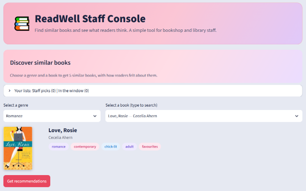
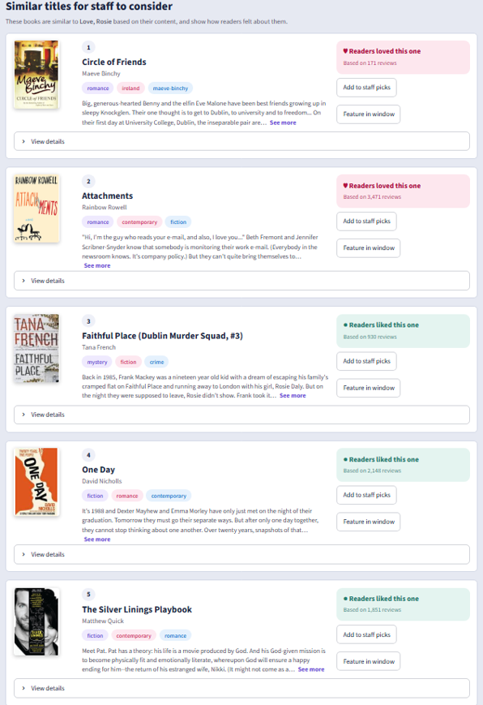

# ReadWell Staff Console

A prototype book recommendation tool for staff in small bookshops and libraries.
It was built for a bachelor's thesis at HAMK University of Applied Sciences (BITCA):
"A content-based book recommendation with sentiment analysis for small businesses".

Staff choose a genre and a book, press "Get recommendations", and see five similar books.
Each recommended book also shows a reception label that tells how readers responded in their reviews.

## How to use

1. Open the app (see "Online version" below, or run it on your computer).
2. Choose a genre, then choose a book. You can type in the book box to search.
3. Press **Get recommendations** to see five similar books.
4. Read the reception label on each card. Open **View details** to see the estimated share of positive reviews.
5. Optional: use **Add to staff picks** or **Feature in window** to keep a short list during your visit.

The tool uses no customer accounts, purchase histories or other personal data.

## How it works

The work is done in two stages.

1. **Preparation (Google Colab notebook, not part of this repository).** The book data is cleaned,
   the TF-IDF data is created and a reception label is calculated for each book. The results are saved as the data files listed below.
2. **Application (Streamlit).** The app loads the saved files when it starts and calculates the five recommendations when a book is selected.
   It does not train or run a sentiment model.

How the five books are chosen:

- Book descriptions and reader-generated tags are each turned into TF-IDF data. The similarity between books is calculated
  with cosine similarity, using a weight of 0.65 for descriptions and 0.35 for tags.
- The rules in `similar_rules.py` are then applied: the selected book is never recommended, boxed sets and collections are removed,
  books from the same series are removed, a book by the same author as the selected book has its score multiplied by 0.40,
  the list has at most one book per series and per author, and books with review data are placed first.

How the reception labels are made:

- A lightweight sentiment model (TF-IDF with Multinomial Naive Bayes) estimates the share of positive reviews for each book.
- Books with at least 10 reviews are ranked by this share. The top 25% get "Readers loved this one", the middle 50% get
  "Readers liked this one" and the bottom 25% get "Mixed reactions". Books with fewer reviews get "Not enough reviews yet".

## What is in this repository

| File | What it is |
|---|---|
| `app.py` | The Streamlit app (the page staff see) |
| `similar_rules.py` | The rules for choosing the five books |
| `books_app.pkl` | The book table (titles, authors, tags, descriptions, years, series, cover links) |
| `tfidf_app.joblib` | The saved TF-IDF data used to find similar books |
| `book_sentiment.csv` | The reception label, number of reviews and share of positive reviews for each book |
| `requirements.txt` | The Python packages the app needs |

Built with Python, Streamlit, pandas, scikit-learn and joblib.

## Run it on your computer

1. Install Python 3 and open a terminal in this folder.
2. Install the packages: `pip install -r requirements.txt`
3. Start the app: `streamlit run app.py`
4. Open the address that Streamlit shows (usually http://localhost:8501).

The data files must stay in the same folder as `app.py`.

## Online version

The app is hosted on Streamlit Community Cloud: (https://book-recommendation-console-readwell.streamlit.app/)

## Data

The books, tags and reviews come from the Goodreads dataset collected by Wan and McAuley. The copy used in this study was
downloaded from Kaggle in October 2026 (`pypiahmad/goodreads-book-reviews1`). The original dataset page is
https://mengtingwan.github.io/data/goodreads, where the terms of use of the dataset are given.

Please cite the original works:

> Wan, M., & McAuley, J. (2018). Item recommendation on monotonic behavior chains. *Proceedings of the 12th ACM Conference on Recommender Systems (RecSys '18)*.

> Wan, M., Misra, R., Nakashole, N., & McAuley, J. (2019). Fine-grained spoiler detection from large-scale review corpora. *Proceedings of the 57th Annual Meeting of the Association for Computational Linguistics (ACL 2019)*.

The dataset is used here for a bachelor's thesis and not for commercial purposes. The data files in this repository are prepared
from it for this study. Book covers are linked from Goodreads or Open Library and are not stored here.

## Limits of this prototype

- It contains 2,941 popular books from three genres (romance, fantasy and mystery), and the newest book is from 2017.
- The reception labels are estimates from a lightweight sentiment model, based on star ratings and on the first part of the review file.
  They are a guide, not an exact score.
- The effect of each selection rule has not been tested separately.
- A small survey (33 respondents, 13 bookshop and library staff) gave an initial view of staff interest. Its usefulness in daily work has not been shown.
- The staff picks and window lists are kept only for the current visit and are not saved.

## Ideas for future work

- Use a shop's own catalog and reviews instead of the Goodreads data.
- Add more books and genres, an author filter and a way to see more than five recommendations.
- Let staff save their lists between visits.
- Test the tool with more users in a real bookshop or library.

## Author

Manasha Siriwardana, HAMK University of Applied Sciences.
Thesis details: [Thesis link ]

## License

[a license]
